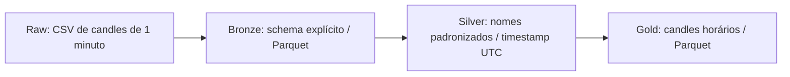

# Bitcoin Pipeline com PySpark

Pipeline batch de engenharia de dados que transforma candles de Bitcoin de um minuto em candles horários, com camadas Raw, Bronze, Silver e Gold, validações de qualidade e testes automatizados.

## Problema e objetivo

Dados de mercado em CSV precisam de tipos consistentes, validação temporal e regras de domínio antes de serem usados em análises. Agregar candles também exige preservar a abertura e o fechamento na ordem correta dos eventos.

Este projeto organiza essas etapas em um pipeline local com Apache Spark: ingere os dados, padroniza o schema e produz uma base horária OHLCV em Parquet. OHLCV representa abertura, máxima, mínima, fechamento e volume.

## Resultados

| Indicador | Snapshot processado |
|---|---:|
| Registros de um minuto processados | 7.753.106 |
| Candles horários gerados na Gold | 129.219 |
| Nulos nas colunas OHLCV e `hour` da Gold | 0 |
| Violações das regras OHLCV na Gold | 0 |
| Horas duplicadas na Gold | 0 |

Esses números descrevem o dataset utilizado nesta versão. A quantidade de linhas da Gold não é uma constante de validação: novos dados podem produzir mais horas sem representar um erro.

## Arquitetura



| Camada | Responsabilidade | Granularidade |
|---|---|---|
| Raw | Arquivo CSV de entrada, mantido localmente | Candle de um minuto |
| Bronze | Aplicar schema explícito e persistir em Parquet | Candle de um minuto |
| Silver | Normalizar nomes e converter segundos Unix em timestamp | Candle de um minuto |
| Gold | Agregar OHLCV por hora e contar registros de origem | Candle de uma hora |

## Dataset

**Fonte:** [Bitcoin Historical Data — Kaggle, mczielinski](https://www.kaggle.com/datasets/mczielinski/bitcoin-historical-data).

**Licença dos dados:** [Creative Commons Attribution-ShareAlike 4.0 International (CC BY-SA 4.0)](https://creativecommons.org/licenses/by-sa/4.0/), conforme informado na página do dataset. Esta referência se aplica aos dados, não define a licença do código deste repositório.

A entrada utilizada é `btcusd_1-min_data.csv`, com cabeçalho e separador vírgula. O schema de leitura é definido em [src/schema.py](src/schema.py):

| Coluna | Tipo na Bronze | Significado |
|---|---|---|
| `Timestamp` | `LongType` | Instante em segundos Unix |
| `Open` | `DoubleType` | Preço de abertura |
| `High` | `DoubleType` | Maior preço |
| `Low` | `DoubleType` | Menor preço |
| `Close` | `DoubleType` | Preço de fechamento |
| `Volume` | `DoubleType` | Volume do candle |

O CSV não é versionado. Para executar o pipeline, forneça uma cópia local em `data/raw/btcusd_1-min_data.csv`. Toda a pasta `data/` é ignorada pelo Git. Os testes usam dados sintéticos e não precisam desse arquivo.

## Transformações

### Bronze e Silver

A Bronze lê o CSV com schema explícito e modo `PERMISSIVE`, mantendo os nomes originais. A validação da ingestão ocorre em um script separado.

Antes de gerar a Silver, o pipeline valida a qualidade da Bronze. A transformação coloca os nomes das colunas em minúsculo e substitui o timestamp numérico por `TimestampType`, usando `timestamp_seconds`. Os valores OHLCV são preservados. A sessão da Silver utiliza UTC.

### Gold horária

A Gold usa UTC e agrupa a Silver pelo início da hora:

| Coluna | Regra |
|---|---|
| `hour` | `date_trunc("hour", timestamp)` |
| `open` | Abertura associada ao menor timestamp, com `min_by` |
| `high` | Máximo de `high` |
| `low` | Mínimo de `low` |
| `close` | Fechamento associado ao maior timestamp, com `max_by` |
| `volume` | Soma dos volumes |
| `record_count` | Quantidade de registros da Silver na hora |

A escolha de abertura e fechamento depende do timestamp, sem depender da ordem física de entrada das linhas.

## Qualidade dos dados

As funções compartilhadas ficam em [src/data_quality.py](src/data_quality.py). Um `column_mapping` associa nomes lógicos aos nomes físicos, permitindo reutilizar métricas na Bronze (`Timestamp`), Silver (`timestamp`) e Gold (`hour`).

| Verificação | Comportamento |
|---|---|
| Nulos nas seis colunas mapeadas | `validar_qualidade` lança `ValueError` |
| Timestamp ou hora duplicada | Conta chaves distintas repetidas e bloqueia na validação |
| `High >= Open`, `High >= Close`, `High >= Low` | Violações bloqueiam na validação |
| `Low <= Open`, `Low <= Close` | Violações bloqueiam na validação |
| `Volume >= 0` | Volume negativo bloqueia na validação |
| Raw e Bronze com a mesma contagem | `abs(total_raw - total_bronze)` deve ser zero |
| Gold com `record_count` entre 1 e 60 | Valores fora do intervalo bloqueiam a escrita |
| Horas internas da Gold com 60 registros | Quantidade diferente bloqueia a escrita |
| Primeira e última hora | Podem ser parciais, com 1 a 60 registros |
| Gaps superiores a 60 segundos na Bronze/Silver | Diagnóstico exibido pelos scripts de validação |
| Contagem Bronze versus Silver | Comparação exibida; não lança erro por divergência |

Nulos são contados separadamente: uma comparação OHLC envolvendo `NULL` não é contada como violação de preço. Na Gold, as validações compartilhadas e de `record_count` são executadas antes da persistência.

## Decisões técnicas

- **Execução local com `local[2]`:** permite estudar e testar o processamento Spark sem provisionar um cluster.
- **Schema explícito:** define tipos de entrada sem depender de inferência do CSV.
- **Funções nativas do Spark:** transformações usam a API de DataFrames, sem UDFs Python.
- **Uma agregação para métricas comuns:** total de registros, nulos e regras OHLCV são calculados juntos. Duplicados exigem um agrupamento separado.
- **Parquet entre camadas:** mantém tipos e permite leitura em formato colunar.
- **Snapshots com `overwrite`:** cada execução reconstrói a camada, sem acumular linhas de execuções anteriores. A reexecução com a mesma entrada busca produzir o mesmo conteúdo lógico, sem garantir nomes ou quantidade idênticos de arquivos.
- **Sem `coalesce` ou `repartition` manual na Gold:** a escrita mantém o particionamento produzido pelo plano Spark.
- **Armazenamento no Ubuntu:** os Parquets ficam em `~/spark-bitcoin-data`, evitando o problema de permissões encontrado ao gravar pelo WSL em `/mnt/c`.
- **Transformações separadas da orquestração:** funções recebem DataFrames; os `main()` cuidam de sessão, leitura, validação e escrita.

## Estrutura

```text
.github/workflows/ci.yaml       # GitHub Actions
src/
├── schema.py                  # Schema do CSV
├── bronze_ingestion.py        # Raw → Bronze
├── validate_bronze.py         # Qualidade e contagem da ingestão
├── silver_transformation.py   # Bronze → Silver
├── validate_silver.py         # Qualidade e diagnóstico da Silver
├── gold_transformation.py     # Silver → Gold, validação e escrita
└── data_quality.py            # Regras compartilhadas
tests/
├── conftest.py                # Sessão Spark de teste em UTC
├── test_silver_transformation.py
├── test_gold_transformation.py
└── test_data_quality.py
requirements.txt
requirements-dev.txt
README.md
```

## Como executar

### Ambiente

O projeto foi desenvolvido com Python 3.12, Java 21, PySpark 4.2.0 e Ubuntu 24.04 via WSL. Os comandos abaixo devem ser executados no Ubuntu, na raiz do repositório.

Com Python 3.12, suporte a `venv` e Java 21 instalados, prepare o ambiente:

```bash
python3.12 -m venv ~/venvs/spark-bitcoin
source ~/venvs/spark-bitcoin/bin/activate
python -m pip install --upgrade pip
python -m pip install -r requirements-dev.txt

export JAVA_HOME="$(dirname "$(dirname "$(readlink -f "$(command -v java)")")")"
export PYSPARK_PYTHON="$VIRTUAL_ENV/bin/python"
export PYSPARK_DRIVER_PYTHON="$VIRTUAL_ENV/bin/python"

python --version
java -version
```

O comando de `JAVA_HOME` usa o Java disponível no terminal; confirme que ele corresponde ao Java 21. Ao abrir outra sessão, ative novamente o ambiente virtual e configure as variáveis `export`.

### Entrada e execução sequencial

Coloque o CSV em `data/raw/btcusd_1-min_data.csv`. Depois execute cada etapa, prosseguindo somente se a anterior terminar com sucesso:

```bash
python -m src.bronze_ingestion
python -m src.validate_bronze
python -m src.silver_transformation
python -m src.validate_silver
python -m src.gold_transformation
```

As saídas são diretórios Parquet:

```text
~/spark-bitcoin-data/
├── bronze/bitcoin_bronze/
├── silver/bitcoin_silver/
└── gold/bitcoin_hourly/
```

Cada camada pode conter vários arquivos `part-*.parquet` e arquivos auxiliares. A leitura deve apontar para o diretório da camada. A execução substitui os dados existentes no destino correspondente.

## Testes e CI

Os 13 testes atuais usam pequenos DataFrames para verificar:

- conversão Bronze → Silver, nomes, tipos e preservação de OHLCV;
- agregação Gold com entrada fora de ordem e separação entre horas;
- contagem de nulos e violações OHLCV;
- identificação de timestamps duplicados;
- gaps com `LongType` e `TimestampType`, além da rejeição de tipos incompatíveis;
- rejeição de horas internas incompletas e contagens fora de 1–60, e aceitação da primeira hora parcial.

Execute localmente:

```bash
python -m pytest -v
python -m ruff check src tests
python -m ruff format --check src tests
```

O [workflow de CI](.github/workflows/ci.yaml) roda em `push` e `pull_request`, em `ubuntu-latest`. Ele configura Java 21 Temurin e Python 3.12, instala `requirements-dev.txt` e executa Ruff lint, verificação de formatação e pytest. O CI não executa o pipeline sobre o CSV completo.

## Escopo e limitações

Esta versão processa um único dataset de Bitcoin em batch local, com reconstrução completa das camadas. Não implementa ingestão incremental nem orquestração agendada.

A detecção de gaps utiliza uma janela global e pode concentrar processamento em uma partição. Ela é diagnóstica e considera intervalos de um minuto. A regra de `record_count` verifica apenas horas presentes na Gold: horas inteiramente ausentes não são detectadas por esse filtro. Ter 60 registros também não comprova, isoladamente, o alinhamento exato de um candle por minuto.
